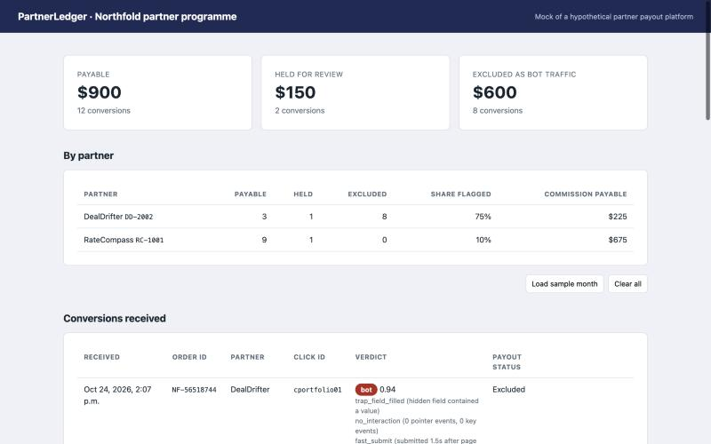
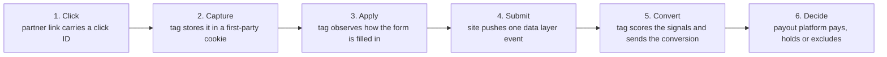
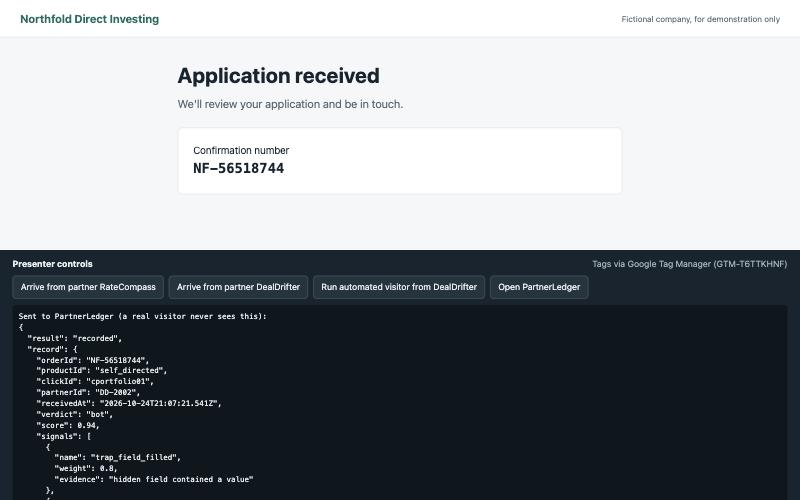

# Northfold: paying partners only for real applicants

A working demo of partner (affiliate) conversion tracking with bot detection built in, deployed through
Google Tag Manager. Every application arrives at the payout system with a verdict (human, suspicious or bot)
and the reasons behind it, so the business pays for people, reviews the uncertain cases, and can show a
partner why a payout was refused.

**Live demo:** https://tinasheadm.github.io/northfold-bot-detection-demo/demo/

Everything here is fictional: the company, the partners and the data.



## The problem

Northfold Direct Investing, a fictional online brokerage, pays its partners $75 for every submitted
application. It cannot tell a real applicant from a script, so it pays commission on bot traffic, and when it
refuses a payout it has no evidence to show the partner.

**Success looks like:** every conversion carries a verdict and its reasons, only verified conversions become
payable, uncertain ones are held for a person to review, and real customers are never blocked.

## How it works



The customer's website builds exactly one thing: an `application_submitted` event with the confirmation
number. Everything else is two Custom HTML tags in Google Tag Manager, so tracking can change, be tested in
Preview and be rolled back without a website release.

| Tag | Trigger | What it does |
| --- | --- | --- |
| Base script and attribution cookie | All Pages | Loads the pixel and saves the partner's click ID for 30 days (last click wins) |
| Conversion with traffic verdict | Custom event `application_submitted` | Sends the conversion, keyed on the confirmation number |

Both tags push commands onto a queue (`plxq.push([...])`), so it does not matter whether the tag or the pixel
script loads first.

## How traffic is scored

The pixel judges how the form was filled in, not who the visitor claims to be. Six signals each carry a weight
between 0 and 1: roughly, how likely that signal alone means a bot.

| Signal | Weight | What it catches |
| --- | --- | --- |
| `automation_flag` | 0.9 | The browser reports it is driven by automation software |
| `trap_field_filled` | 0.8 | A field hidden from people was filled in |
| `no_interaction` | 0.5 | No real mouse, touch or keyboard input at all |
| `form_not_observed` | 0.5 | The submission happened before the pixel could observe it |
| `fast_submit` | 0.4 | Submitted under 3 seconds after the page loaded |
| `no_typing` | 0.3 | Clicks but no key presses (autofill, or a simple script) |

The weights combine into a score:

```text
score = 1 - (1 - w1) x (1 - w2) x ... x (1 - wn)
```

Each `1 - w` is the chance that signal has an innocent explanation; their product is the chance that every
signal is innocent. A score of 0.75 or more is a **bot**, 0.25 to 0.75 is **suspicious**, and anything lower is
**human**.

| Case | Signals | Score | Verdict |
| --- | --- | --- | --- |
| Person typing the form | none | 0.00 | human |
| Person using autofill | `no_typing` | 0.30 | suspicious |
| No input, under 3 seconds | `no_interaction`, `fast_submit` | 0.70 | suspicious |
| Scripted visitor | `trap_field_filled`, `no_interaction`, `fast_submit` | 0.94 | bot |

By design, behaviour alone tops out at 0.70. A bot verdict needs hard evidence: the hidden field was filled,
or the browser reported automation.



### Principles

- **Three verdicts, not two.** Uncertain traffic is held for review, never rejected outright.
- **Every verdict carries its reasons**, so a partner dispute can be answered with evidence.
- **Fail safe.** If the pixel cannot run, the application still completes and the conversion is held.
- **One payment per order.** The confirmation number is the idempotency key, so a reload never pays twice.

### What a production system would add

This demo shows the browser layer of a layered approach. Browser signals can be faked by a determined
attacker; they raise the cost of fraud and catch cheap automation. A production system would also:

- score on the server and never reveal the verdict to the visitor (the demo computes it in the browser so it
  can be shown on screen);
- add server-side checks, such as network reputation and request volumes from one address;
- use a specialist device-identification service for disguised browsers and repeat offenders;
- tune the hand-picked weights against a labelled set of known human and scripted runs.

## Try it

On the live demo, use the controls bar at the bottom of each page:

1. **Arrive from partner RateCompass**, start the application, type the form by hand and submit. Verdict: human.
2. **Arrive from a partner**, press **Autofill form**, then submit. Verdict: suspicious, held for review.
3. **Run automated visitor from DealDrifter** and keep your hands off. Verdict: bot, excluded.
4. **Open PartnerLedger** to see the payout decisions, and **Load sample month** for a month of history.

To run it locally:

```bash
python3 -m http.server 8765 --directory demo
```

Then open http://localhost:8765. The pages must be served over HTTP; opened directly as files, the cookie and
the shared storage do not work.

## Deploying through your own Tag Manager container

The tags are loaded from container `GTM-T6TTKHNF`. To use your own:

1. Create a web container and go to **Admin > Import Container**.
2. Import `demo/gtm/container-import.json` with **Merge**, then **Submit** and **Publish**.
3. Put your container ID in `demo/assets/config.js`.

Leave `gtmId` empty to make the same two calls directly from the page, with no container at all.

## Project structure

| Path | Role |
| --- | --- |
| `demo/index.html`, `apply.html`, `thank-you.html` | The fictional customer's website |
| `demo/assets/plx.js` | The pixel: attribution, observation, scoring, sending |
| `demo/assets/site.js` | The site's own code and the demo controls |
| `demo/ledger.html`, `demo/assets/ledger.js` | Mock of a partner payout platform |
| `demo/gtm/container-import.json` | The Tag Manager tags, triggers and variables |
| `docs/TESTING.md` | The end-to-end test plan |

No frameworks, no build step and no server code: plain HTML, CSS and JavaScript.

## Testing

[docs/TESTING.md](docs/TESTING.md) lists eleven end-to-end tests, from attribution to duplicate handling,
and how the Tag Manager deployment was verified in Tag Assistant.

## How it was built

Built as a solutions engineering exercise: one customer problem, one workflow, one outcome. The scenario and
the tracking approach come from my own experience implementing partner tracking integrations. It was tested
end to end in Safari and through Google Tag Manager.
